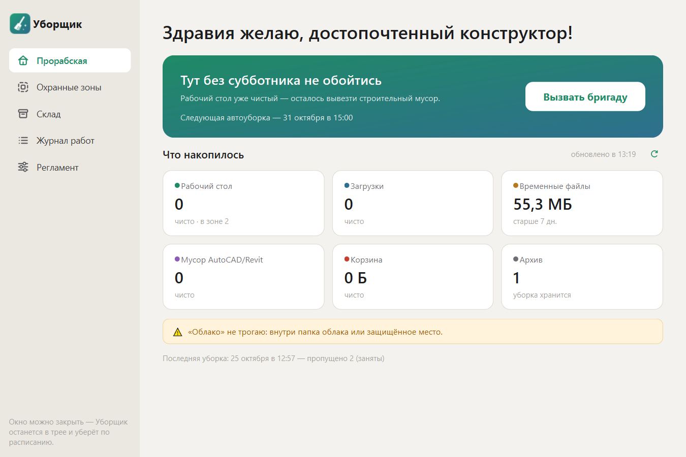

# Уборщик

> Чистый рабочий стол — чистая совесть и хорошие проекты.

Наводит порядок на рабочем столе Windows: уносит файлы в архив с датой, чистит
Загрузки, TEMP, корзину и мусор AutoCAD/Revit. Архив живёт 90 дней. Что лежит в
**охранной зоне** (рамка на столе) — не трогает. Облака не трогает никогда.



## Скачать
- **[Уборщик-Setup-1.0.0.exe](https://github.com/soseregasarychev-dotcom/cleaner/releases/download/v1.0.0/Uborshchik-Setup-1.0.0.exe)** (31 МБ) —
  установщик для Windows 10/11 (64-бит). Запустить → в синем окне SmartScreen
  «Подробнее» → «Выполнить в любом случае» → «Далее» → «Готово». Права администратора не нужны.
- **[Конспект «Чистый рабочий стол»](https://github.com/soseregasarychev-dotcom/cleaner/releases/download/v1.0.0/Chistyj-rabochij-stol-konspekt.pdf)** (PDF, 6 стр.) —
  петля проектировщика, установка, что умеет программа и как выйти из петли.

Первая уборка всегда идёт по смете: без вашего «Согласовать снос» ничего не удаляется.

## Сборка из исходников
```powershell
python -m venv .venv
.\.venv\Scripts\python.exe -m pip install -r requirements.txt
powershell -ExecutionPolicy Bypass -File scripts\build.ps1
```
Программа ставится в `%LOCALAPPDATA%\Programs\Uborshchik\Уборщик.exe`, ярлык — в меню «Пуск».
При первом запуске прописывается в автозапуск (выключается в «Настройках»).

## Как пользоваться
1. **Что не трогать → Нарисовать зону** — обведите мышью область рабочего стола,
   где лежит нужное. Она будет видна как пунктирная зелёная рамка.
2. **Главная → Убрать сейчас** — откроется список: что уедет в архив, что удалится.
   Снимите лишние галочки, правый щелчок — «больше никогда не трогать».
3. Дальше Уборщик сам убирает раз в 10 дней в 21:00 (за минуту спросит —
   можно отложить на час или на завтра). Живёт в трее.

Архив: `Рабочий стол\Архив\ГГГГ-ММ-ДД\`. За 7 дней до удаления придёт уведомление.

## Разработка
```powershell
.\.venv\Scripts\python.exe -m pytest
.\.venv\Scripts\python.exe -m uborshchik --dry-run   # посмотреть план, ничего не меняя
.\.venv\Scripts\python.exe -m uborshchik             # запустить окно из исходников
```

## Установщик (передать другу)
```powershell
winget install JRSoftware.InnoSetup                      # один раз
powershell -ExecutionPolicy Bypass -File scripts\installer.ps1
```
Получится `dist\Уборщик-Setup-<версия>.exe` (~35 МБ): ставится без прав администратора
в `%LOCALAPPDATA%\Programs\Uborshchik`, ярлык в «Пуск», удаляется через «Параметры → Приложения»
(вместе с автозапуском и настройками; архив на рабочем столе остаётся). Подписи нет — при первом
запуске Windows SmartScreen попросит «Подробнее → Выполнить в любом случае».
